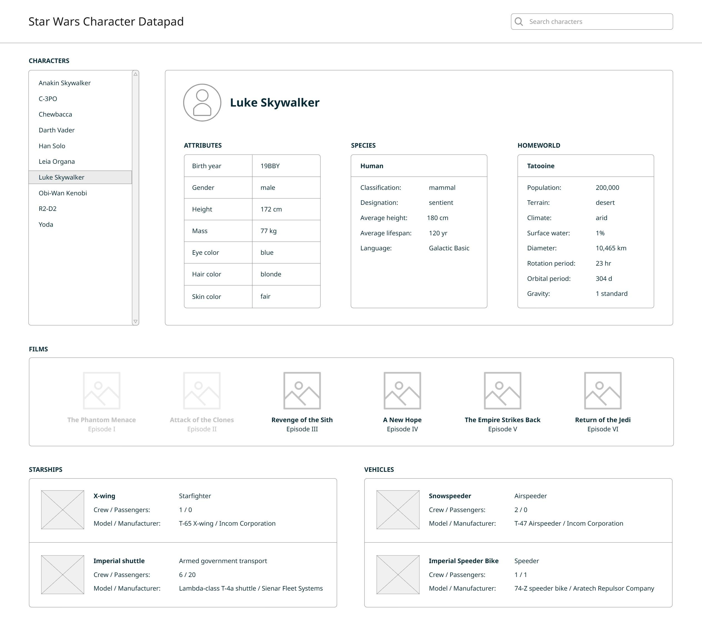

# Instructions - Senior Software Engineer

## The Exercise

Build a small application that allows a user to explore information about characters from the Star Wars API ([https://swapi.info/](https://swapi.info/)).

A wireframe has been provided to illustrate the general idea. Your application should allow a user to:
- View a list of characters.
- Search for a character.
- Select a character and view relevant details, including attributes, species, and homeworld.
- View related information, such as the films the character appears in and the starships or vehicles the character pilots.
- Clearly communicate loading, empty, and error states.

The wireframe is a starting point, not a pixel-perfect specification. You may make reasonable design and implementation decisions based on the time available.

It is expected that you only implement the single-page view shown in the wireframe. Links to separate pages for films, vehicles, or other entities are not required.

Actual images or icons of entities are not required. Feel free to use image placeholders where appropriate.

---

## What We Are Looking For

This exercise is intended to help us understand how you approach a small, practical software problem. For a Senior Software Engineer, we are interested in your ability to shape the solution, make sound architectural decisions, anticipate risks, and deliver a reliable implementation that could be maintained and extended by a team.

We will consider:
- Whether the application works and satisfies the core requirements.
- The readability, structure, and long-term maintainability of your code.
- How you define boundaries, responsibilities, and abstractions within the solution.
- Your use of automated tests to verify important behavior and provide confidence when making changes.
- How you handle API communication, missing data, failures, and other expected edge cases.
- The architectural decisions and tradeoffs you make within the available time.
- Whether the solution is appropriately designed for the size of the problem without unnecessary complexity.
- The quality of your Git history, issues, and technical documentation.
- Your ability to explain and defend your decisions, evaluate alternatives, identify risks, and recommend pragmatic next steps.

You should focus on delivering a complete and reliable solution while demonstrating strong software design, architectural judgment, and a holistic understanding of how the application could evolve. We are interested not only in what you build, but also in how your decisions would help a team safely maintain, test, and extend it.

---

## Guidelines

Please spend no more than a few hours on the exercise. We are not expecting a production-ready application, and we do not expect you to implement every improvement you identify.

Use the programming language, framework, and tools you know best. This is not the time to experiment with an unfamiliar language or technology stack.

Your solution may be delivered as a web, mobile, or desktop application.

You may use AI-assisted development tools, but be prepared to explain how you used them, what they produced, and how you evaluated, corrected, and validated their output. You remain responsible for understanding all submitted code and the technical decisions represented in the solution.

You should include automated tests that verify important behavior. Use your judgment to determine the appropriate testing strategy, which areas carry the most risk, and where tests provide the greatest confidence within the available time.

Commit your work to a GitHub repository regularly so we can understand how the solution developed. Do not submit the entire project as a single final commit.

Create GitHub issues for the work you plan to complete and associate your commits with the relevant issues. Use the issues to demonstrate how you decomposed the work, identified dependencies or risks, and prioritized what could reasonably be completed within the time available.

Each GitHub issue should have an estimate.

If you have questions or where requirements are unclear, document the assumptions you made as part of your README file, including alternatives you considered and why you chose to proceed in a particular direction.

---

## Submission

Send us a link to a GitHub repository containing your solution. The repository should include a README with:
- Instructions for installing and running the application.
- Instructions for running the tests.
- Any assumptions you made.
- A brief description of your technical approach and overall architecture.
- Important architectural decisions, tradeoffs, and alternatives you considered.
- Technical risks or limitations you identified.
- Features or improvements you would prioritize with more time.
- A brief note describing how you used and validated AI-assisted tools, if applicable.
- Any guidance you would give another engineer who needed to maintain or extend the application.

---

## Follow-Up Discussion

During the next interview, you will walk us through your application and discuss your approach. Be prepared to demonstrate the solution, explain the architecture and testing strategy, defend key technical decisions, and discuss alternatives you considered.

---

## Wireframe Mockup

